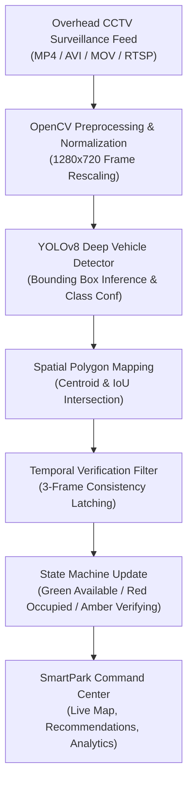

# SmartPark AI – Automated Parking Slot Occupancy Detection System Using Overhead CCTV for Smart City Parking Management

**Academic Context:** College S5 AIML Capstone Project  
**Tech Stack:** Python 3.11, Streamlit, OpenCV, YOLOv8 (Ultralytics), PyTorch, Plotly, Pandas

---

## 📌 Executive Overview

**SmartPark AI** is an intelligent vision-based parking management prototype designed for smart cities, commercial malls, and high-security campuses. Rather than deploying expensive physical ultrasonic or geomagnetic ground sensors for every individual parking bay (which suffer from high battery failure rates and tarmac drilling costs), SmartPark AI utilizes existing high-angle **Overhead CCTV Surveillance Cameras** to monitor and track parking slot occupancy in real time.

---

## 🚀 Key Innovations & System Features

1. **Sequential Core System Flow & Module Locking**
   - Upon initial dashboard launch, only the **Dashboard** and **Upload Video** pages are active.
   - All critical features (**Parking Map, Emergency Parking, Smart Recommendation, Analytics, Settings**) remain locked 🔒 until surveillance video footage is uploaded and verified by the AI engine.
   - Once analysis finishes, all modules automatically unlock with real-time telemetry.

2. **Temporal Verification Engine (3-Frame Sequential Latch)**
   - Eliminates false positives caused by transient shadows, headlights, or pedestrian crossings.
   - When a slot detects an incoming vehicle or departure, it transitions to an amber **VERIFYING** state.
   - Only when observed consistently across **3 consecutive frames** does the state officially transition to **OCCUPIED** or **AVAILABLE**.

3. **Theatre-Style Parking Map Layout**
   - Realistic bidirectional corridor:
     - **North Entrance Gate (Top Center)**
     - **South Automated RFID Exit Barrier (Bottom Center)**
     - **Central Drive Corridor (Bidirectional lane markings)**
     - **Zone A (West Lot: P01–P07)**
     - **Zone B (East Lot: P08–P14)**
   - Neon glowing states:
     - 🟢 **Neon Green Glow**: Available
     - 🔴 **Neon Red Glow**: Occupied
     - 🟡 **Amber Glow**: Verifying (3-frame buffer)
     - ⚪ **Slate Grey**: Maintenance (P07)
     - 🔵 **Blue Outline**: Dedicated ADA Accessible Bay (P02)
     - 🟣 **Purple Outline**: Emergency Reserved Bay (P11)

4. **Multi-Mode Recommendation Engine**
   - **Normal Mode:** Filters out special bays and recommends the optimal available regular bay closest to the entrance.
   - **Accessible Mode:** Prioritizes P02 (dedicated ramp access); gracefully falls back to closest available bay if occupied.
   - **Quick Exit Mode:** Recommends closest bay to South automated exit gate (P14/P13) for minimum outbound transit time.
   - **Emergency Mode:** Prioritizes Emergency Reserved Bay P11 or P02 based on emergency severity (Medical, Elderly, Patient, Urgent), providing dispatch codes and barrier override.

5. **Deep Space Navy Cybernetic UI Theme**
   - Background: `#050B2B`
   - Glassmorphism translucent cards with `backdrop-filter: blur(16px)`
   - Typography: **Rajdhani** for military/cybernetic headings and **JetBrains Mono** for technical telemetry and confidence meters.

---

## 🏗️ End-to-End Pipeline Architecture



---

## 📂 Project Structure

```
smartpark-ai/
├── app.py                     # Main Streamlit Dashboard & Navigation
├── config.py                  # Theme colors, slot geometries, distances, constants
├── detector.py                # YOLOv8 object detection & OpenCV slot mapping
├── slot_manager.py            # 3-frame temporal verification state machine & alerts
├── recommender.py             # Smart multi-mode recommendation engine
├── utils.py                   # Realistic synthetic CCTV video generator & CSV export
├── test_pipeline.py           # Comprehensive automated pipeline test suite
├── run_app.bat                # Windows 1-click launcher
├── yolov8n.pt                 # YOLOv8 neural network weights
└── assets/
    ├── css/style.css          # Deep space navy & glassmorphism custom CSS
    └── demo_parking_video.mp4 # Pre-generated realistic surveillance video
```

---

## 🏃 How to Run the Prototype

### Option 1: One-Click Windows Launcher
Double-click:
```bat
run_app.bat
```

### Option 2: Command Line
Open terminal in `C:\Users\kirth\.gemini\antigravity\scratch\smartpark-ai` and run:
```powershell
python -m streamlit run app.py
```
Then open your browser at `http://localhost:8501`.

---

## 🎓 Viva / Presentation Guide

1. **Q: Why use YOLO rather than basic background subtraction (MOG2)?**
   - *A:* Background subtraction is vulnerable to dynamic lighting changes, shadows of clouds/trees, and day-to-night transitions. YOLOv8 is an anchor-free convolutional model that detects vehicles semantically regardless of shadow conditions.

2. **Q: Why is 3-frame temporal verification necessary?**
   - *A:* Overhead cameras occasionally suffer frame drops or partial occlusions (e.g., a tall van passing in the central drive lane briefly casting a shadow over P04). The 3-frame sequential buffer requires a slot state change to persist across consecutive frames before locking, preventing UI flicker.

3. **Q: How are special slots (P02, P11, P07) guarded?**
   - *A:* They have dedicated boolean flags and strict constraints in `recommender.py`:
     - `P07`: Permanently hardcoded to `MAINTENANCE` status. Cannot be selected or recommended.
     - `P02`: ADA Accessible slot near entrance. Locked for regular users, only recommended in Accessible Mode.
     - `P11`: Emergency Reserved slot near exit. Locked permanently for normal cars, only unlocked in Emergency Parking dispatch.
